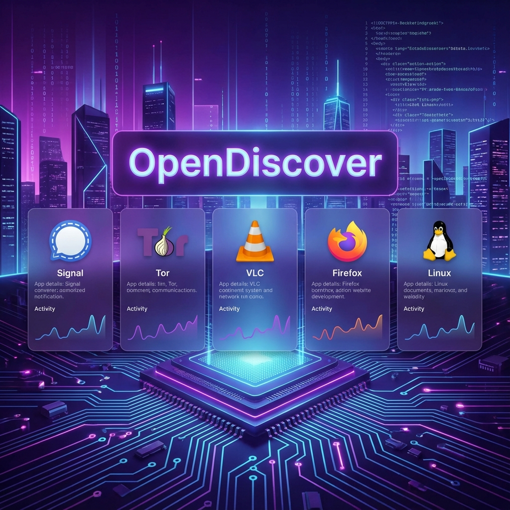

# Krishna Platform 🛡️✨



**Krishna** is a next-generation platform designed to help users find, verify, and trust open-source applications. We solve the problem of discovery by curating high-quality tools, AI models, and privacy-focused apps in a modern, beautiful interface.

> "Discover the code that powers the future."

---

## 🚀 Key Features

### 🔍 Smart Discovery
-   **Advanced Search**: Instantly find apps like "Signal", "Tor", or "Llama 3" with fuzzy search logic.
-   **Categorized Hubs**: Dedicated sections for **Open Source Apps** (Privacy), **AI/ML Models**, **Dev Tools**, and **Productivity**.

### 🛡️ Trust & Security
-   **Trust Score™**: A transparent scoring system (0-100) based on license type, update frequency, and community health.
-   **Verified Badges**: Easily spot projects with verified source code and OSI-approved licenses.
-   **License Explainer**: Interactive tooltips that translate complex legal jargon ("MIT", "GPL") into plain English.

### 🤝 Community Driven
-   **Submission System**: Users can submit new projects directly via our integrated Google Form.
-   **Community Links**: Direct access to project discussions, issues, and funding pages.

### ⚡ Modern UI/UX
-   **Glassmorphism Design**: A premium dark-mode aesthetic with neon accents and blur effects.
-   **Responsive Stats**: SVG visualizations for download trends and activity.

---

## 🛠️ What We Use (Tech Stack)

This project is built with a modern, performance-first stack:

-   **Frontend**: [React 18](https://react.dev/) with [TypeScript](https://www.typescriptlang.org/) for robust type-safe code.
-   **Build Tool**: [Vite](https://vitejs.dev/) for lightning-fast HMR and bundling.
-   **Styling**: **Vanilla CSS & CSS Modules** with a custom design system (Variables for HSL colors, glass effects). No heavy UI frameworks.
-   **Routing**: [React Router DOM](https://reactrouter.com/) for seamless single-page navigation.
-   **Icons**: Emoji-based iconography for lightweight performance.
-   **Deployment**: Ready for **GitHub Pages** and **Firebase Hosting**.

---

## 📸 Screenshots


*The main dashboard featuring curated open source applications.*

---

## 🏁 Getting Started

### Prerequisites
-   Node.js (v18+)
-   npm

### Installation

1.  **Clone the repo**
    ```bash
    git clone https://github.com/krishna3163/new-project.git
    cd new-project
    ```

2.  **Install Dependencies**
    ```bash
    npm install
    ```

3.  **Run Development Server**
    ```bash
    npm run dev
    ```
    Open `http://localhost:5173` to view it in the browser.

---

## 📨 Contact

Have questions or suggestions?

-   **Maintainer**: Krishna
-   **Email**: [kk3163019@gmail.com](mailto:kk3163019@gmail.com)
-   **Submit a Project**: [Use our Submission Form](/submit)

---

*© 2025 Krishna. Built with ❤️ for the Open Source Community.*
